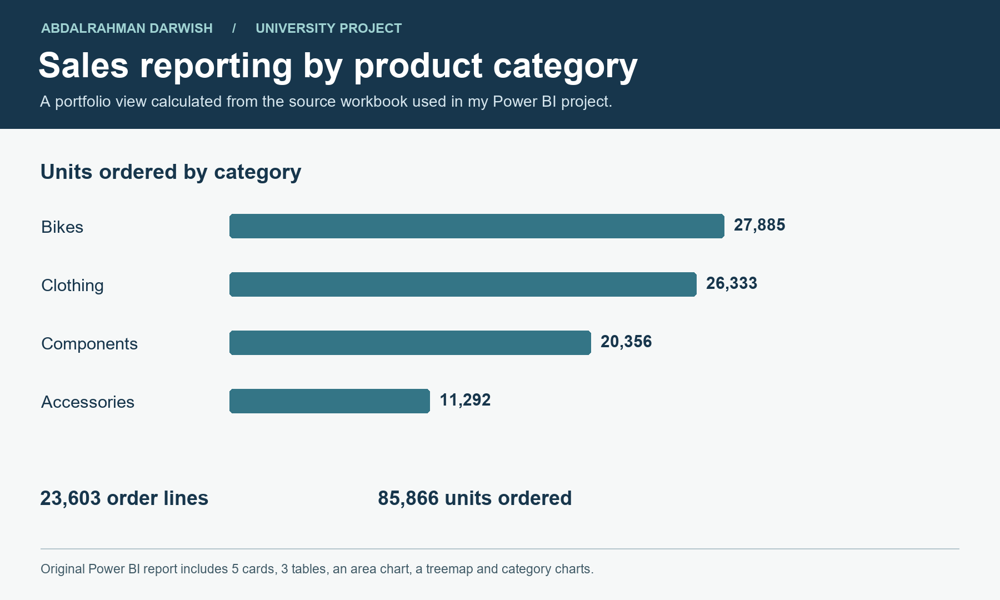

# Sales and order reporting in Power BI
I built a Power BI report to show how order volume changes over time and which territories, shipping methods and product categories account for those orders.

## What the report measures
The source workbook contains 23,603 order lines across 1,465 distinct orders, covering 85,866 units. Bikes led with 27,885 units, followed by clothing with 26,333. Together they accounted for 63.1% of units.

The image summarizes the source workbook. The original Power BI report has five KPI cards for order count, line total, freight, tax and total due. It also breaks down orders by date, shipping method, product hierarchy, status and territory.

## Explore the portfolio version
- [Category totals](category-summary.csv) contains the four aggregated rows behind the chart. In Power BI Desktop, use **Get data > Text/CSV**, then place `category` on a bar chart's category axis and sum `units_ordered` on its value axis.
- [Visual field mappings](visual-fields.json) lists the chart types and field bindings extracted from the original Power BI report.
- The order count uses distinct order IDs. An order may contain several lines, and a line may contain several units.
